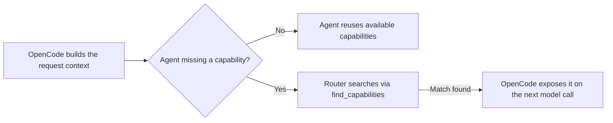

# OpenCode Capability Router

[](https://github.com/robertluiz/opencode-capability-router/actions/workflows/ci.yml)
[](https://github.com/robertluiz/opencode-capability-router/actions/workflows/opencode-2.2.0.yml)
[](https://github.com/robertluiz/opencode-capability-router/actions/workflows/opencode-2.3.2.yml)
[](https://github.com/robertluiz/opencode-capability-router/actions/workflows/opencode-2.4.1.yml)

Discover tools and skills on demand in OpenCode. Eligible agents start with a smaller tool list, find what they need with `find_capabilities`, and keep selected tools available across follow-up messages and context compaction.

## Compatibility

**Supported OpenCode versions: 2.2.0 and later in the 2.x series.** The table distinguishes versions tested in Docker from versions not yet verified.

| OpenCode version | Status |
| --- | --- |
| 2.2.0, 2.3.2, 2.4.1 | Tested in Docker: discovery, capability reuse after compaction, and semantic indexing with inherited and explicit models. |
| Other 2.x versions from 2.2.0 onward | Not individually tested. |
| 2.0.0 | Not fully compatible. The plugin API lacks `ctx.tool.list()`, which semantic indexing requires, and the compaction test did not complete. |
| Other versions below 2.2.0 in the 2.x series | Not supported; not tested. |
| 1.x | Not compatible. The plugin requires the V2 agent and session APIs. |

## Quick start

Requires Node.js and OpenCode 2.2.0 or later in the 2.x series. Run the installer for your operating system from this checkout or the extracted package directory.

**Windows (PowerShell):**

```powershell
.\install.ps1 -WhatIf  # Preview; optional
.\install.ps1
```

**macOS:**

```sh
sh ./install-macos.sh
```

**Linux:**

```sh
sh ./install-linux.sh
```

> The installers for macOS and Linux have not yet been tested on those operating systems.

Restart OpenCode and start a new session. The installer copies and registers the plugin without replacing your agent settings. To try discovery, select an existing `router` or `orchestrator` agent and ask it to find a missing capability:

```text
Find a way to read logs/startup.log without running commands or modifying files.
```

If neither agent exists, add `"router": { "mode": "primary" }` to the `agents` object in your OpenCode configuration, then reload and select `router`. The indexer does not need this step.

## How it works



- Use tools and skill instructions already available. Search only for what is missing.
- Use an exact ID for a known capability. For a natural-language search, include the action, object, and any constraints that change the choice.
- If both a tool and a skill are needed, leave `kind` unset and search for them together. Otherwise, use `kind` to narrow the search.
- Discovery does not execute tools or load skill instructions. OpenCode still enforces access and execution permissions.

For normal primary agents other than `router` and `orchestrator`, the plugin leaves the existing tool list alone.

## Results and context savings

- **Capability reuse:** In an isolated Docker test, one discovery call was enough for **37 completed reads across 9 automatic compactions**, including a follow-up message, with no tool errors.
- **Query size:** A separate benchmark ran the same 36-turn workload with identical results and one search per turn. Short queries were 31 bytes; long queries were 237 bytes.

| Benchmark | Peak request: long → short | Total request traffic: long → short |
| --- | ---: | ---: |
| No compaction | 42.9 → 35.5 kB (**17% less**) | 2.63 → 2.22 MB (**15% less**) |
| Two compactions | 19.4 → 16.7 kB (**14% less**) | 1.43 → 1.27 MB (**11% less**) |

These are measured request bytes from controlled Docker runs, not billed tokens or a comparison against loading the full tool catalog. Total traffic includes repeated history and, where applicable, compaction requests. Reuse already available capabilities and keep new queries short without dropping constraints.

## Semantic indexing and privacy

On startup, the plugin registers an isolated `indexer` if none exists. An existing `indexer` is preserved and must be a subagent with all permissions denied. When indexing is available, it runs separately without tools and inherits the triggering session's settings unless explicitly overridden. Discovery uses textual matching when indexed concepts are unavailable.

Indexing sends tool and skill names and descriptions and may incur charges. Do not put sensitive data in catalog metadata. To turn semantic indexing off, set `OPENCODE_SEMANTIC_INDEX_ENABLED=0` in the environment that starts OpenCode. Textual discovery still works.

An explicit `OPENCODE_SEMANTIC_INDEX_MODEL` setting takes precedence over `agents.indexer.model`. Invalid or unsupported settings do not fall back to another configuration. Changing this setting alone does not rebuild the index.

## Install elsewhere or uninstall

The default configuration is `opencode/opencode.json` under `$env:XDG_CONFIG_HOME` (or `$HOME/.config`). The package is installed under `$env:XDG_DATA_HOME` (or `$HOME/.local/share`) at `opencode/capability-router/package`.

To use a different profile or package directory, pass `-ConfigPath` and `-Destination` on Windows, or `--config` and `--destination` on macOS and Linux. Use the same values to uninstall. Keep the destination outside the profile's plugin autodiscovery directory. The installer expects strict JSON and refuses to overwrite unmanaged or modified packages.

```powershell
.\uninstall.ps1 -WhatIf
.\uninstall.ps1
```

On macOS and Linux, run `node ./manage.mjs uninstall .` from the checkout or package directory.

Restart OpenCode after uninstalling. Uninstall removes the registration, preserves unrelated settings, and does not delete the index.

## Test and package

Run the local checks from the source checkout:

```powershell
node --test eval/router-compaction.test.mjs indexer-model-test.mjs storage-test.mjs
```

`eval/README.md` documents the Docker and optional live tests. To build a local package, create `dist` and run `npm pack --pack-destination dist`. Only the package allowlist is included.

For questions and bug reports, use the repository's Issues tab. Include the OpenCode version and the smallest reproducible example; remove credentials and private logs.
